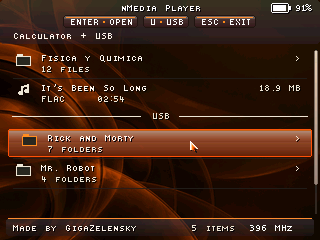
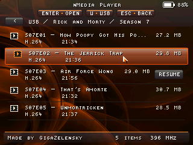
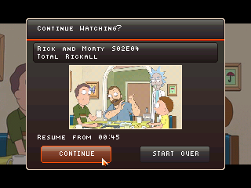
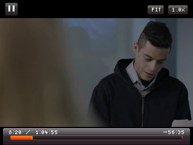
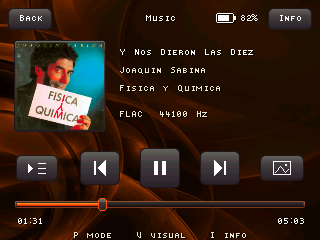
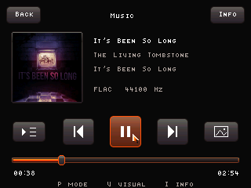
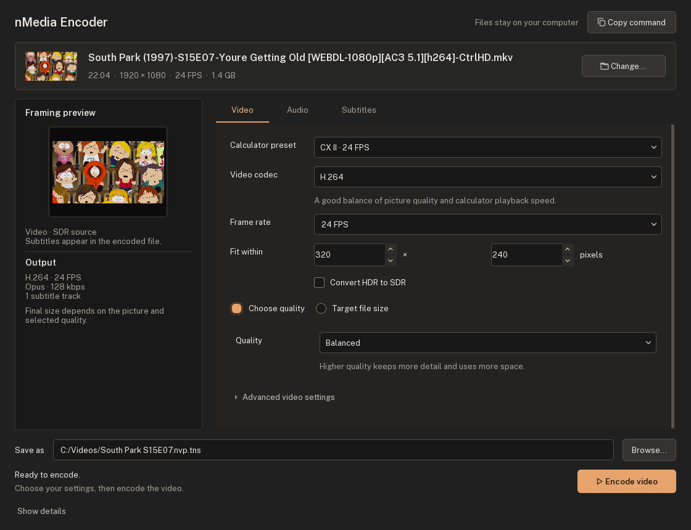
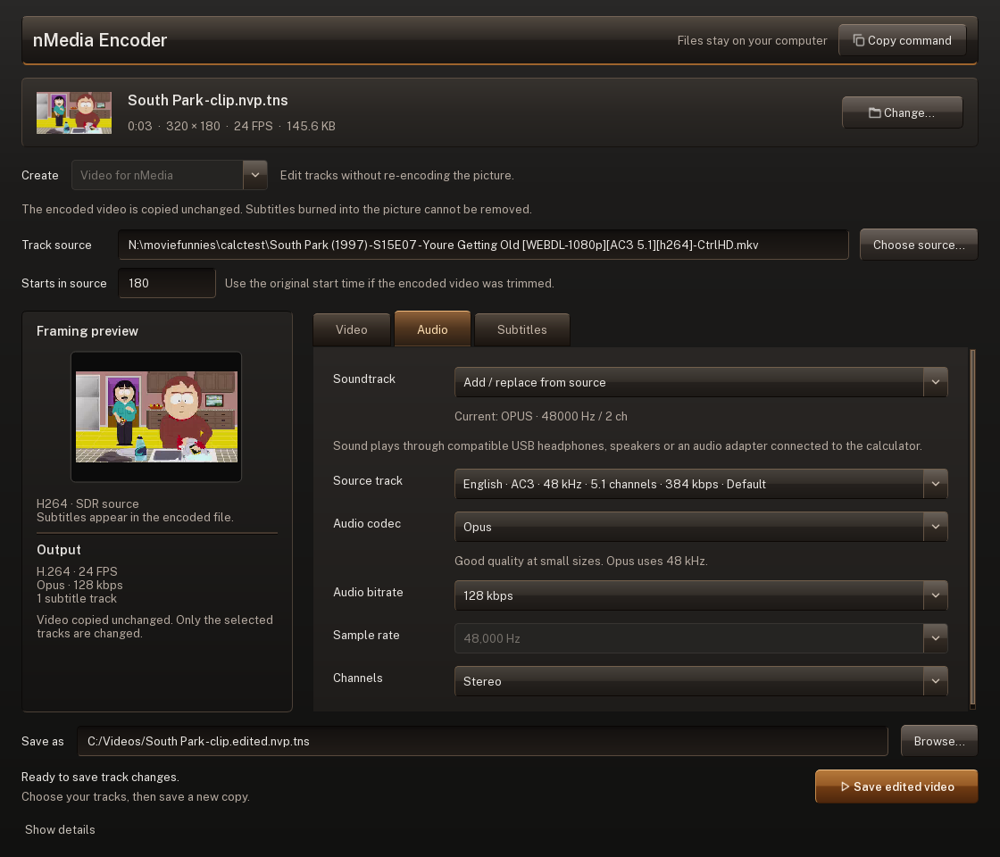
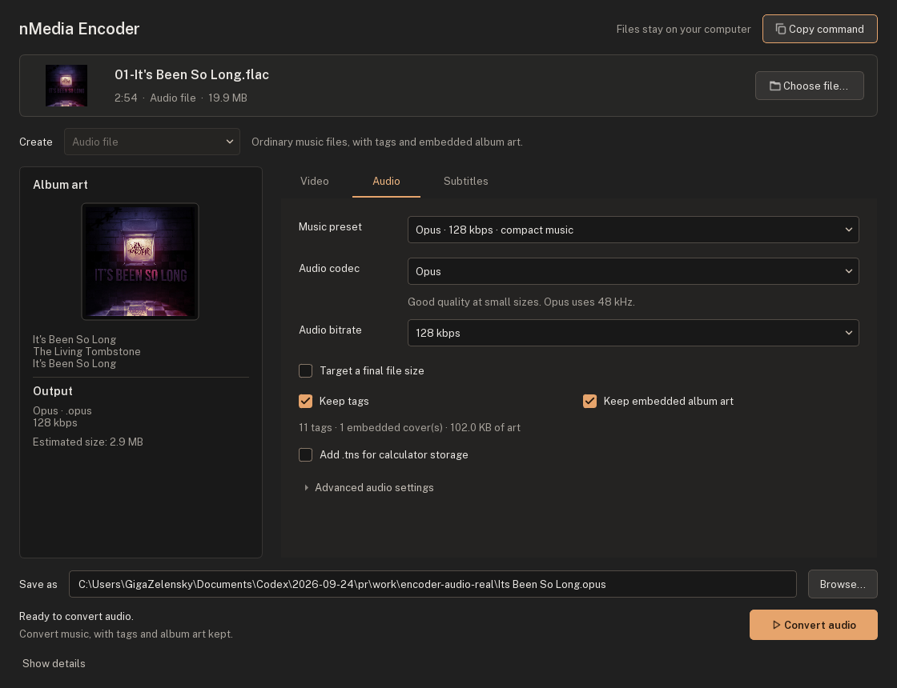

# nMedia Player

A native media player for the **TI-Nspire CX, CX II and CX II-T**, powered by Ndless.
Watch videos with subtitles, play ordinary music files, browse calculator or USB
storage, and listen through USB headphones, speakers or a DAC.

## Screenshots

| Calculator and USB library | Folder navigation | Continue watching |
| --- | --- | --- |
|  |  |  |

| Playback and seek preview | Live-action | Subtitles |
| --- | --- | --- |
|  |  |  |

| Music and album art | It's Been So Long | Vortex |
| --- | --- | --- |
|  |  |  |

[More screenshots and capture details](./examples/README.md).

## Current Format

The `.nvp` format used by the current player is:

- H.264 Annex B video bitstream in legacy version 9/10 containers
- H.264, H.265 (HEVC), AV1 or MPEG-4 Part 2 video in version 11 codec-tagged containers
- version 12 containers with 64-bit offsets for large movies, selected automatically by the encoder
- version 13 containers with an optional synchronized audio track
- chunked container with per-chunk frame tables
- optional text subtitle tracks stored in the container
- raw stored chunk payloads

## Features

- native Ndless runtime
- CX and CX II LCD paths through Ndless' native framebuffer modes
- streamed playback from calculator storage or a USB flash drive
- folder navigation with breadcrumbs and Back on both storage sources
- password-protected videos with authenticated AES-256 encryption
- H.264 decode through `h264bsd`
- H.265 / HEVC decode through an optimized `libde265` port
- AV1 decode through an optimized `dav1d` port
- MPEG-4 Part 2 decode through vendored Xvid sources
- RGB565 output
- direct storage reads on CX and CX II, with decoded frames prepared ahead for smoother playback
- SRAM lookup tables on CX II; original CX uses ordinary RAM
- accurate frame pacing from a hardware-backed monotonic timer
- subtitle support for text subtitle tracks
- built-in subtitle font cycling
- scale modes: `FIT`, `FILL`, `STRETCH`, `1:1`
- playback speed control from `0.25x` to `4.0x`, including `2.5x` and `3.5x`
- selectable CPU clocks: default 132 MHz on CX/CX CAS and 396 MHz on CX II, selectable up to 240 / 492 MHz
- the selected speed works on battery and USB, and is reapplied after in-app standby
- restore the previous clock speed on exit, or keep the selected speed
- screen brightness control with `Shift` + `Up` / `Down` and an on-screen percentage overlay
- adjustable warm night filter
- idle dimming, screen-off and automatic standby
- theme color profiles: `Amber`, `Blue`, `Green`, and `Red`
- picker UI for videos and music, with separate file sizes and hover details
- picker filename metadata tooltips from bracketed tags
- resume history with saved playback, subtitle, and theme settings
- ordinary WAV (PCM/IMA), MP3, FLAC, Ogg Vorbis, AAC and Opus music playback
- USB audio output through compatible UAC1/UAC2 devices, directly or through supported hubs
- music tags, JPEG/PNG covers, expandable album art and an information overlay
- Flow, Vortex, Prism and Pulse music visualizations
- shared animated volume controls with finer adjustment at low levels
- opt-in debug log output and in-player memory/playback overlay

## Decoder Loading and Buffering

All four video decoders live inside the Full `_nMedia.tns`, but only the one needed for the
current video is loaded into RAM. Switching formats unloads the previous
decoder once playback and previews have finished using it. There are no extra
files to install, and decoder code stays in RAM throughout playback. The last
decoder is kept ready for reopening videos in the same format.

This saves roughly **1.2–1.3 MiB of RAM during HEVC or AV1 playback** compared
with keeping every decoder loaded. H.264, HEVC and AV1 keep most buffered pictures
in compact YUV form, using 25% less memory per picture than RGB565. The next few
pictures are converted to screen-ready RGB ahead of presentation. The buffer
uses measured free RAM while reserving space for decoding and other player work.

Opening a different format can add a short decoder-loading step. Single-codec
builds load their decoder with the app and remain the smallest download.
Audio modules are also bundled in the app and loaded on demand, with no separate
codec files to install.

## Current Limits

- ordinary video files such as MP4/MKV need conversion to `.nvp.tns`; music files play directly
- sound requires compatible USB audio hardware because the calculators have no built-in audio output
- a Lite/custom build only plays its selected codecs; known unavailable video codecs appear in red in the library

## Battery Life

Battery Life: ~9.5 hours of continuous H.264 playback at 100% brightness on a CX II-T.

## Controls

Press `Catalog` during playback to open the built-in controls guide.

### Shared Controls

These work in the picker, playback and resume prompt. Playback shortcuts are
inactive while entering a password.

| Key | Action |
| --- | --- |
| `C` | Cycle theme color |
| `S` | Save a BMP screenshot, including player error dialogs (disabled for encrypted video) |
| `O` | Open processor speed settings; also available from the picker's MHz label |
| `Scratchpad` | Save state and open OS Scratchpad |

### Picker

- `Up` / `Down` or keypad `8` / `2`: select media
- touchpad: move cursor
- touchpad hover: show the title, filename metadata and video duration
- touchpad click: open highlighted movie
- `Enter` or keypad `5`: open movie or folder
- `Right` / keypad `6`: open selected folder; `Left` / keypad `4`: parent folder
- `U` or the USB button: connect/rescan a USB drive
- `Esc`: parent folder, or exit from the library

### Movie Filename Metadata

The picker hides the full video extension and supports optional bracketed metadata in movie filenames.

Example:

```text
Rick and Morty S07E03 [English SDH].nvp.tns
```

The list row shows `Rick and Morty S07E03`. Hover briefly to see the clean title, `English SDH` metadata and the video duration on separate lines. Multiple bracketed tags are joined with ` | ` in the tooltip.

### Playback

- `Space`: play / pause with a small pause indicator, or restart when the movie has ended
- touchpad: move cursor and show the UI
- `Enter` / keypad `5` / touchpad click: play / pause, restart at end, click hovered controls, or seek inside the bottom UI band
- `Left` / `Right` or keypad `4` / `6`: seek `-5s` / `+5s`
- keypad `7` / `9`: switch to the previous / next video in the current directory
- `Up` / `Down` or keypad `8` / `2`: increase / decrease volume
- `Shift` + those vertical keys: increase / decrease screen brightness
- `Ctrl` + `M`: mute / unmute
- `N`: toggle night mode
- `Ctrl` + touchpad `Up` / `Down`: enable night mode, then adjust its intensity; hold to repeat. At 0%, night mode is off.
- `Tab`: single-frame step while paused, hold to repeat
- `P`: cycle playback mode: `PLAY ONCE`, `REPLAY`, `AUTO NEXT`
- `R`: toggle realtime sync, allowing displayed-frame drops instead of slowdown
- `/`: cycle scale mode
- `Ctrl` + keypad `1`-`9`: align video
- `{` / `}`: decrease / increase playback speed
- `^`: cycle subtitle placement
- `+` / `-`: increase / decrease subtitle size, down to hidden
- `F`: cycle subtitle font
- `T`: cycle subtitle track
- `M`: toggle memory / playback diagnostics overlay
- `D`: toggle performance recording and diagnostic logging (off by default)
- `Catalog`: open / close the help overlay
- `Esc`: close help, or leave the movie if help is not open
- `On`: smoothly turn the screen off or back on; while off, `Esc` saves history and returns to the OS home menu

Night mode also works in the picker and resume prompt. Its intensity is remembered while the app is open.

Seeking shows the frames leading up to the destination. Play/pause works during
that catch-up, and repeated seek presses extend the destination. On arrival,
playback returns to the paused or playing state from before the seek.

### Music Playback

| Key / pointer | Action |
| --- | --- |
| `Space` | Pause/resume |
| `Left` / `Right`, `4` / `6` | Stack 5-second seeks; hold to repeat |
| `7` / `9`, `Shift+Tab` / `Tab` | Previous / next song in the current folder |
| `Up` / `Down`, `8` / `2` | Volume; hold to repeat |
| `Shift` + those vertical keys | Brightness |
| `Ctrl+M` | Mute/unmute |
| `P` / mode button | Play once, repeat this song, continue through folder |
| `V` / view button | Cover, Flow, Vortex, Prism, Pulse |
| `I` / Info | Tags, filename, source, size, duration and audio details without pausing |
| `C`, `N`, `Ctrl+Up/Down`, `O` | Theme, night filter/intensity, processor settings |
| Timeline / cover | Drag to seek / expand cover; click or Esc closes the cover |
| `Esc` | Close the overlay, cancel a drag or pending seek, or return to the picker |

The timeline supports clicks and dragging. Previous restarts the current song
after three seconds; otherwise it selects the previous track. Click a cover to
expand it and click again or press Esc to close it, without pausing the music.
Touch the middle of the right edge to reveal the volume drawer; drag its knob
or click the speaker to mute. Volume uses a curve for finer control at low levels.

### Processor Speed

Click the track, drag the knob, or use Left/Right or 4/6. The orange mark shows
the applied speed. **Test** compares the selected speed with the default,
then restores the previous setting. **Apply** changes this session;
the choice is saved in `ndvideo-data/ndhistory.ts.tns` only on normal app exit. A reset or crash
won't save a new choice. The short benchmark measures speed, not long-term stability.

Default uses the normal unplugged speed even on USB: 132 MHz on CX and
396 MHz on CX II. Exit restores the OS's original clock settings unless
**Keep speed after exit** is checked. This option is saved with the selected speed.

### Resume Prompt

- `Left` / `Right` or keypad `4` / `6`: choose `CONTINUE` or `START OVER`
- touchpad: move cursor
- touchpad click: activate the highlighted button
- `Enter` or keypad `5`: confirm the selected button
- `Esc`: cancel and return

## Encrypted Videos

Locked movies ask for their password before loading. Type with the keyboard;
hold `Shift` for uppercase and use `Tab` for symbols. `Enter` or a touchpad click presses the hovered
control, or the outlined default (Unlock unless you select a symbol with the arrow keys).
`Return` always presses Unlock. Playback shortcuts stay disabled while entering a password.
`Del` deletes and `Esc` cancels. Unlocking takes a while on the calculator;
the progress indicator stays responsive. The key is cleared when you leave the video.
Screenshots are disabled while an encrypted video is visible.

Install `cryptography` with `python -m pip install cryptography`, then add
`--encrypt` to your usual encoder command. It prompts for a password of up to
128 printable ASCII characters. For scripts, use `--password-file PATH`.

To encrypt an existing movie without re-encoding:

```sh
python tools/nve_crypto.py movie.nvp.tns locked.nvp.tns
```

Video, subtitles and the internal index are encrypted in independently verified
16 KiB records, so seeking still works. File size grows by about 0.2%.
The filename, duration and codec stay visible; original files and any requested
preview are kept unencrypted. New encrypted files include an authenticated
codec label and require the updated player. Older encrypted files still play;
their codec becomes visible after opening them in the current library session.

## Idle Power Management

In the picker, resume prompt or paused playback, the screen dims after one minute, turns off after two, and enters standby after three. Input wakes the screen; active video playback keeps it awake. On the verified CX II-T firmware, standby resumes directly in the player. Other firmware uses the normal OS suspend path.

During music, idle dim/off timers and the On key can turn the display off while
sound continues. A key/touch wakes it without also triggering a control. Music
does not suspend the CPU while audio is playing. Paused video and the library
can enter standby.

## Subtitle Fonts

The built-in subtitle font cycle currently includes:

- `Tinytype`
- `VGA`
- `Thin` (default)
- `Space`
- `Fantasy`

## Repository Layout

- [src/player](src/player): native player shell and playback/UI implementation
- [src/audio](src/audio): music metadata, audio decoders and USB audio output
- [src/movie](src/movie): `.nvp` container format definitions
- [src/storage/usb](src/storage/usb): EHCI bulk transport, SCSI commands and read-only FAT/exFAT access
- [src/codecs](src/codecs): codec adapters and vendored decoder sources
- [src/codecs/h264bsd](src/codecs/h264bsd): H.264 decoder sources
- [src/codecs/hevc](src/codecs/hevc): H.265 / HEVC decoder sources
- [src/initfini.c](src/initfini.c): startup / shutdown glue
- [tools/encode_ndless_video.py](tools/encode_ndless_video.py): PC-side encoder
- [tools/pack_zehn.py](tools/pack_zehn.py): Zehn packer used by the build
- [examples/screenshots](examples/screenshots): README screenshot assets
- [examples](examples): packaged sample files for quick calculator-side testing
- [Makefile](Makefile): build entry point

## Build

### Requirements

- Ndless SDK
- ARM GCC toolchain available in `PATH`
- `make`
- `bash`
- Python 3.10 or newer
- `pyelftools`

### Build Command

The SDK libraries must be built first; GitHub Actions contains the complete setup.

```sh
make PROFILE=full       # dist/_nMedia.tns
make PROFILE=lite       # dist/_nMedia-lite.tns
make release            # packages those two builds, symbols, licenses and checksums
```

Custom builds select exactly the codecs/features needed:

```sh
make PROFILE=custom CODECS="h264 mpeg4" AUDIO_CODECS="mp3 opus" USB_STORAGE=1 ARTWORK=1 VISUALIZATIONS=0
make PROFILE=custom CODECS="" AUDIO_CODECS="mp3 opus" USB_STORAGE=0 ARTWORK=0 VISUALIZATIONS=0
```

Video choices: `h264 mpeg4 hevc av1`. Audio choices: `pcm ima mp3 flac vorbis aac opus`.
`USB_STORAGE`, `ARTWORK` and `VISUALIZATIONS` are 0/1 switches. An empty
`AUDIO_CODECS=""` removes audio, including the USB audio implementation; its artwork
and visualizations must be off. `CODEC_MODULES` and `AUDIO_MODULES` control on-demand
versus static decoder linking. Selected modules are always bundled inside the app.
USB audio can still work with `USB_STORAGE=0` when audio codecs are enabled.

Custom output is `_nMedia-custom.tns`; archive each custom result separately.
Each build writes a JSON feature manifest. Build objects are isolated by codec
and feature selection. Official releases contain Full and Lite rather than every
combination. [Architecture and validation](docs/media-development.md).

### Build Output

The build writes the selected player to [dist](dist), with its matching ELF,
Zehn and JSON feature manifest. Release symbols contain the matching decoder
modules. Checksums and shared license texts are included alongside the players.

## Encoder

The encoder turns a normal video file into a streamed `.nvp.tns` movie. H.264 is
the default and writes version 10 containers. `--codec hevc` selects H.265;
`--codec av1` selects AV1; `--codec mpeg4` selects MPEG-4 Part 2.
These alternatives use version 11 containers.

### Desktop encoder (Windows)

Download **`nMedia-Encoder-Windows-x64.exe`** from [Releases](https://github.com/GigaZelensky/Nspire-MediaPlayer-Ndless/releases/latest). Open it, choose or drop a video or music file, then choose **Video for nMedia** or **Audio file**. Python is not required for the executable. It runs native FFmpeg on your computer and does not upload your media.

The GUI can select soundtrack languages/titles and subtitle tracks, embed text subtitles or burn them in, trim/crop a video, convert HDR to SDR, and target a total file size. Choose quality or a size preset/custom MB target; **Two-pass encoding** is selectable for video, and **Encoding effort** controls the computer's encoding preset. The video budget subtracts the soundtrack and reserves 3% for overhead; final video size can vary. Existing output is replaced only after encoding succeeds. **Copy command** gives the equivalent Python CLI command, which remains available below.

For music, choose a preset or set the codec and bitrate yourself. Outputs are ordinary **Opus, MP3, AAC/M4A, Ogg Vorbis, FLAC, PCM WAV or IMA-ADPCM WAV** files. Text tags and embedded covers are kept by default, including accented text, multiple artists, album/track/disc information and additional text tags. JPEG/PNG covers are copied without recompression. Old encoder, duration and loudness-analysis tags are discarded because they describe the previous encoded stream. AAC/M4A converts other cover image types to PNG when necessary. **Add .tns for calculator storage** adds the suffix without changing the audio format.

Music can also target a final size, including the tags and cover. The app calculates a bitrate from the duration, checks the completed file and lowers the bitrate if needed to fit. This works with Opus, MP3, AAC and Vorbis; lossless/WAV formats cannot promise a chosen size. Audio does not use video-style two-pass encoding. A music file's source sample rate is kept where the codec supports it; Opus uses 48 kHz, and MP3/AAC/Vorbis output is limited to 48 kHz. The source channel setting keeps mono/stereo and downmixes multichannel audio to stereo.

| Encode a source video | Edit an encoded video's tracks | Convert music |
| --- | --- | --- |
|  |  |  |

To run the GUI from source:

```powershell
python -m pip install -r requirements-encoder.txt
python tools/encode_gui.py
```

To build the executable, install `requirements-encoder-build.txt` and run `python tools/build_encoder_gui.py`. GitHub Actions builds and tests the app, including an actual encode and cancellation inside the packaged executable, and attaches it to releases. The Windows executable targets Windows 10/11 x64; it does not support Windows XP.

Audio-only conversion is also available from the CLI (install `requirements-encoder.txt` first):

```powershell
python .\tools\convert_audio.py "song.flac" --output "song.opus" --codec opus --bitrate 128
python .\tools\convert_audio.py "song.flac" --output "song.mp3" --codec mp3 --target-mb 4
```

Tags and embedded art are kept automatically. Use `--strip-tags` or `--strip-art` to omit either; `--track N` selects an audio track when extracting audio from a movie.

Open an existing unencrypted `.nvp.tns` in the same app to edit its tracks. You can keep, replace or remove its soundtrack and selectable subtitles without encoding the video again. Choose the original video (or an audio file) as the track source when adding audio; if the encoded video was trimmed, enter where it starts in the original. Image subtitles already burned into the picture cannot be removed this way.

The track editor is also available from the CLI:

```powershell
python tools/edit_ndless_video.py "movie.nvp.tns" --output "movie-silent.nvp.tns" --audio remove --strip-subtitles
python tools/edit_ndless_video.py "movie.nvp.tns" --output "movie-with-audio.nvp.tns" --audio replace --track-source "original.mkv" --audio-track 0 --audio-codec opus --audio-bitrate 128
```

Use repeated `--source-subtitle-track N` options for text subtitles from the original, or `--subtitle "captions.srt"` for an external file. Original-source subtitles follow `--source-start`; external subtitle files should already match the encoded video's timeline. Edited output is written as a new file. Encrypted NVPs and formats older than version 10 are not supported by the track editor.

### Python Requirements

Download/clone the whole repository, rather than only the encoder script: it
imports sibling helpers such as `av1_stream.py` and `audio_track.py`.
Use Python 3.10 or newer, with:

```bash
pip install imageio-ffmpeg numpy pillow
```

### Basic Example

```powershell
python .\tools\encode_ndless_video.py "C:\path\to\video.mp4" --output ".\dist\video.nvp.tns"
```

### MPEG-4 Part 2 Example

```powershell
python .\tools\encode_ndless_video.py "C:\path\to\video.mp4" --codec mpeg4 --output ".\dist\video-mpeg4.nvp.tns"
```

### H.265 / HEVC

HEVC trades more decoding work for smaller files at similar image quality.
It is especially useful for animation at modest frame rates; H.264 remains the
better general-purpose choice when smooth playback matters more than file size.
Detailed scenes and higher frame rates can still exceed the calculator's speed,
even with an overclock. Smaller files do not necessarily decode faster.

For example, a 320x180, 16 FPS animation encode went from 23.29 MiB in H.264 to
12.39 MiB in HEVC at similar quality, with no lags reported at 1x on a CX II-T
running at 492 MHz.

```powershell
python .\tools\encode_ndless_video.py "C:\path\to\animation.mkv" `
  --codec hevc --fps 16 --max-width 320 --max-height 180 `
  --stream-profile quality --crf 29.5 --preset veryslow `
  --max-chunk-kib 64 --idr-frames auto --subtitle embedded `
  --output ".\dist\animation-hevc.nvp.tns"
```

This is a starting point, not a fixed quality target. Lower CRF gives higher
quality and larger files; CRF values are not equivalent between H.264 and HEVC.
`--stream-profile fast` reduces decoding work at a detail cost. `balanced` and
`quality` allow smaller coding blocks and spend more encoding time on compression.

HEVC needs FFmpeg with `libx265` and a player version with HEVC support; older
releases cannot play these files. The encoder selects the supported Main 8-bit
settings automatically. Subtitles, encryption, previews and two-pass bitrate
encoding work as usual. Encoding can take considerably longer than H.264.

Use `--idr-frames auto` or a frame count. Oversized groups of frames are shortened
automatically to fit the chunk limit. `--idr-frames byte-auto` and `--level` are
H.264-only.

### AV1

AV1 offers another option for smaller files, at a higher decoding cost. It has
been tested on a CX II-T, but demanding scenes can still stutter even at
492 MHz. Animation at modest frame rates is a useful starting point; H.264
remains the better choice for playback speed.

Use Full `_nMedia.tns`, or a custom build with `av1` enabled. The
example below uses 16 FPS; `--fps source` keeps the original frame rate.

```powershell
python .\tools\encode_ndless_video.py "C:\path\to\animation.mkv" `
  --codec av1 --fps 16 --max-width 320 --max-height 180 `
  --stream-profile quality --crf 42 --preset slow `
  --max-chunk-kib 64 --idr-frames auto --subtitle embedded `
  --output ".\dist\animation-av1.nvp.tns"
```

AV1 requires FFmpeg with `libaom-av1`. CRF is an integer from 0 to 63; lower
values mean higher quality and larger files. `slow`, `veryslow` and `placebo`
map to encoder speeds 2, 1 and 0. The encoder selects 8-bit 4:2:0, avoids hidden
frames and expensive filters, and keeps chunks independently seekable.
Subtitles, encryption, previews and two-pass bitrate encoding work as usual.
CRF values are not comparable across codecs, and AV1 encoding can take a long
time. Smaller output does not guarantee faster playback.

### Audio Tracks

H.264 plus Opus at 128 kbps, retaining the source frame rate:

```sh
python tools/encode_ndless_video.py "input.mkv" --output "movie.nvp.tns" --codec h264 --fps source --audio --audio-codec opus --audio-bitrate 128
```

Video-only encoding is the default. `--audio` alone uses IMA; choose Opus/MP3/AAC/Vorbis for compressed audio.

To inspect soundtrack languages and titles before encoding:

```sh
python tools/encode_ndless_video.py "input.mkv" --list-audio-tracks
```

Add `--audio-track 1` to select the second source soundtrack (indices start at 0),
or `--audio-track ask` for a prompt. When multiple tracks exist, a terminal prompts
if no index was supplied; automated commands default to track 0. The output currently
contains **one selected soundtrack**. Add `--subtitle embedded` for text subtitles,
and repeat `--subtitle-track N` to keep specific subtitle tracks.

`--bitrate-kbps N --two-pass` targets the video size; `--audio-bitrate N` separately
controls compressed audio. Total size is roughly `(video kbps + audio kbps) ×
duration seconds / 8`, in kilobytes, plus container overhead. Choosing a smaller
source download does not by itself reduce the encoded result.

Audio choices are `pcm`, `ima`, `mp3`, `flac`, `vorbis`, `aac` and `opus`.
`--audio-rate` and `--audio-channels` select the sample rate and channel count.

### Embedded Subtitles

```powershell
python .\tools\encode_ndless_video.py "C:\path\to\video.mkv" --subtitle embedded --output ".\dist\video.nvp.tns"
```

### Burn Subtitles Into Video

```powershell
python .\tools\encode_ndless_video.py "C:\path\to\video.mkv" --subtitle embedded --burn-subtitles --output ".\dist\video.nvp.tns"
```

### Burn Larger Subtitles Into Video

```powershell
python .\tools\encode_ndless_video.py "C:\path\to\video.mkv" --subtitle embedded --burn-subtitles --burn-subtitle-size 1.5 --output ".\dist\video.nvp.tns"
```

`--burn-subtitle-size` scales burned subtitles relative to the default output-safe size. It works for text subtitle burns and embedded bitmap subtitle burns.

### Write a Preview MP4

```powershell
python .\tools\encode_ndless_video.py "C:\path\to\video.mkv" --subtitle embedded --burn-subtitles --preview-mp4 --output ".\dist\video.nvp.tns"
```

`--preview-mp4` also writes a video-only `.preview.mp4` next to the `.nvp.tns` output so you can quickly inspect subtitle burn, framing, and quality on PC before copying the movie to the calculator.

### Preserve Source Framerate

```powershell
python .\tools\encode_ndless_video.py "C:\path\to\video.mkv" --subtitle embedded --fps source --output ".\dist\video.nvp.tns"
```

### Recommended Full-Episode Example

```powershell
python .\tools\encode_ndless_video.py "C:\path\to\video.mkv" --subtitle embedded --output ".\dist\video.nvp.tns" --fps 16 --max-width 320 --max-height 180 --max-chunk-kib 64 --stream-profile quality --crf 14.5 --preset veryslow --level 1.3
```

### Target A Specific Size With 2-Pass ABR

```powershell
python .\tools\encode_ndless_video.py "C:\path\to\video.mkv" --output ".\dist\video.nvp.tns" --fps 16 --max-width 320 --max-height 180 --max-chunk-kib 64 --idr-frames byte-auto --stream-profile quality --bitrate-kbps 140 --two-pass --preset veryslow --level 1.3
```

Use CRF when you want the best quality-per-bit without caring about the exact final size. Use `--bitrate-kbps ... --two-pass` when you need a tighter size target.

Chunks are packed by `--max-chunk-kib`; `64` is a starting point, not a fixed
performance target. Very small chunks can force frequent keyframes, increasing
file size and decoding work, especially with HEVC and AV1. Larger chunks trade
more RAM and longer seek catch-up for fewer keyframes. `--chunk-frames` adds an
optional frame-count ceiling (`0` disables it).
`--idr-frames auto` estimates a fixed keyframe interval from the bitrate and byte cap.

`--idr-frames byte-auto` measures frame sizes and splits oversized GOPs while
leaving the others alone. Files that already fit skip refinement. Analysis is
cached for repeat encodes and nearby bitrate changes; every final chunk is still
checked. `--max-chunk-overshoot-percent` permits small near-misses without adding
more keyframes just to shave off a few bytes.

When `--fps` caps or changes the framerate, the encoder timeline-samples frames and then verifies the encoded frame count against the intended duration. The `.json` sidecar records source fps, target fps, expected frames, actual frames, and drift in milliseconds.

### Main Encoder Options

- `--codec`
- `--audio`
- `--audio-codec`
- `--audio-bitrate`
- `--audio-rate`
- `--audio-channels`
- `--audio-track`
- `--list-audio-tracks`
- `--output`
- `--subtitle`
- `--burn-subtitles`
- `--burn-subtitle-size`
- `--subtitle-track`
- `--fps`
- `--max-width`
- `--max-height`
- `--active-aspect`
- `--crop`
- `--chunk-frames`
- `--idr-frames`
- `--max-chunk-kib`
- `--max-chunk-overshoot-percent`
- `--crf`
- `--bitrate-kbps`
- `--two-pass`
- `--preset`
- `--level`
- `--stream-profile`
- `--start`
- `--duration`
- `--timeline-drift-tolerance-ms`
- `--preview-mp4`
- `--quiet`

Run `python tools/encode_ndless_video.py --help` for the full CLI.

## Diagnostics

Debug logging is off by default. Press `D` during playback to start or stop a
recording, then leave the movie normally to save `ndvideo-debug.log.tns`. History,
settings, error logs, and debug recordings live in `ndvideo-data` beside the player,
including recordings of USB videos. This folder is hidden from the video picker.
Recording ends with that movie; auto-next does not overwrite its files.
Totals cover the entire run; frame details keep 128 frames before each lag
and two seconds afterward. Overlapping windows are merged. Storage is bounded,
and the log reports if older detail was replaced. Routine recordings require
`D`; failures can also save `ndvideo-error.log.tns`. Standby details are included
in the same debug log.

Automatic error reports start a fresh complete record once their file reaches
64 KiB, bounding repeated-error growth. Successful music playback does not create
a timing report. Recording adds overhead; compare normal playback with `D` off.

The `M` overlay shows:

- tracked movie-buffer usage (not total OS memory)
- cache usage
- current frame
- contiguous decoded runway
- decode target
- lag count
- ring-hit vs direct-decode counts
- whether verbose debug logging is currently enabled

Normal playback and successful USB connections do not write diagnostic logs.
Errors save `ndvideo-error.log.tns` in `ndvideo-data`. To record a USB connection
attempt, hold `D` while pressing `U`. This also saves `ndvideo-usb.log.tns` and
an exit audit, including successful attempts. For a failed connection, include
the error report and any USB diagnostic files you deliberately recorded.
Missing-codec notices and other routine player messages do not start a recording.

With `D` enabled, the player can also maintain alternating `ndvideo-crash-a.bin.tns`
and `ndvideo-crash-b.bin.tns` journals on supported firmware. These preserve recent
state if a freeze prevents normal log export. They are not written during
ordinary playback with recording off.

The [examples](examples) folder includes a short packaged sample movie to try on your calculator.

## Install On Calculator

Get the player from [Releases](https://github.com/GigaZelensky/Nspire-MediaPlayer-Ndless/releases/latest).
There are two downloads, each installed as a single calculator file:

| Player | Includes |
| --- | --- |
| **Full: `_nMedia.tns`** | H.264, MPEG-4, HEVC, AV1; PCM/IMA WAV, MP3, FLAC, Vorbis, AAC, Opus; USB storage/audio, covers and visualizations |
| **Video Lite: `_nMedia-lite.tns`** | Local H.264 video, subtitles, seeking, resume and encryption; no audio or USB |

1. Install Ndless for your calculator's OS version.
2. Create an `nMedia` folder on the calculator and copy the chosen player into it.
3. Put media beside the app or inside its subfolders, then open the player.

Videos need the included encoder to become `.nvp.tns` files. Music plays directly
from ordinary supported files; on calculator storage, add `.tns` to the filename
(`song.opus.tns`, for example). The encoded audio bytes stay unchanged.
JPEG/PNG album covers can also use a `.tns` suffix locally.

The Full build carries its decoders inside the app and loads the needed modules
on demand. There are no separate codec files to install. Known video codecs
missing from a Lite/custom build appear in red in the library and show a notice
when opened. Lite plays movies with soundtracks silently.

## USB Libraries

Use a Mini-USB **OTG host adapter** and a high-speed USB drive formatted as
FAT16, FAT32 or exFAT. Create `nMedia` at the drive's root and copy encoded
videos or ordinary music into it. Folders can be nested to organize movies,
series, seasons and albums. Full includes USB storage; Video Lite is local-only.

```text
nMedia/
  Rick and Morty/
    Season 1/
      S01E01.nvp.tns
      S01E02.nvp.tns
  Movies/
    Shrek.nvp.tns
  Music/
    Album/
      01 - Song.opus
      cover.jpg
```

An older `ndvideo` root folder is still accepted when `nMedia` is absent.
USB entries appear below calculator media in the same library. Open
folders one at a time, with breadcrumbs and Back for navigation. The player
attempts automatic detection; **U / USB** connects or refreshes the drive.
Videos and music play directly from USB, without copying them to calculator storage.

Movie sizes use 64-bit file positions. Use exFAT for individual movies larger
than 4 GiB; FAT32's per-file limit still applies. Movies are streamed in small
blocks, so a larger file does not need to fit in RAM.

The USB filesystem is read-only. History, settings and logs are stored in
`ndvideo-data` beside the player on the calculator. Screenshots also stay on
the calculator.

## USB Audio

The calculator has no built-in audio output. Connect a compatible USB headset,
speaker or DAC through a **Mini-USB OTG adapter**. A passive 3.5 mm adapter without
a USB audio device cannot provide sound. Use a compatible USB hub for simultaneous
storage and audio.

The audio host recognizes compatible UAC1/UAC2 PCM interfaces, including supported
devices behind hubs. Hardware tests use a CX II-T with a HyperX Cloud III USB adapter
and a hub's built-in USB DAC. Original CX video/storage has been tested, but CX audio
and every USB audio/hub combination have not. Audio devices that need proprietary
drivers or unsupported sample formats may not work.

## License

Unless noted otherwise, the software in this repository is licensed under the GNU General Public License, version 3. See [LICENSE](LICENSE).

Bundled components' credits and licenses are collected in
[THIRD_PARTY_NOTICES](THIRD_PARTY_NOTICES).
