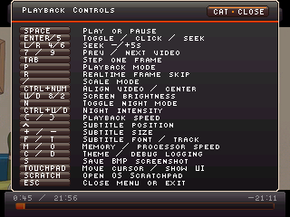
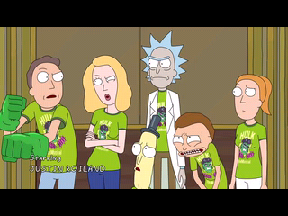

# Examples

This folder contains:

- a short Family Guy sample encode produced with the current H.264 encoder settings
- current UI screenshots used by the root README

Download the player from the repository's releases; it is not stored here.

Licensing note:

- the sample movie encode is not covered by the repository software license
  and remains subject to the rights in its original media and subtitle sources
- the included Family Guy intro sample is provided only for research,
  educational, and non-commercial testing purposes

## Screenshots

| Playback controls | Animation without overlays |
| --- | --- |
|  |  |

The images are rendered at the player's native 320×240 resolution using its
current C drawing routines, nSDL fonts and cursor, with representative library
and playback state. They document the UI; they are not hardware performance
measurements.

Rick and Morty stills use short H.264 CRF 14 encodes of the source at 320×180.
The subtitle example uses the default Thin font, normal size and bottom placement.
The live-action image uses the larger Mr. Robot S01E01 HEVC encode (320×180,
source frame rate, about 88 MiB), at 08:20. These media images remain subject
to the rights in their original sources.
